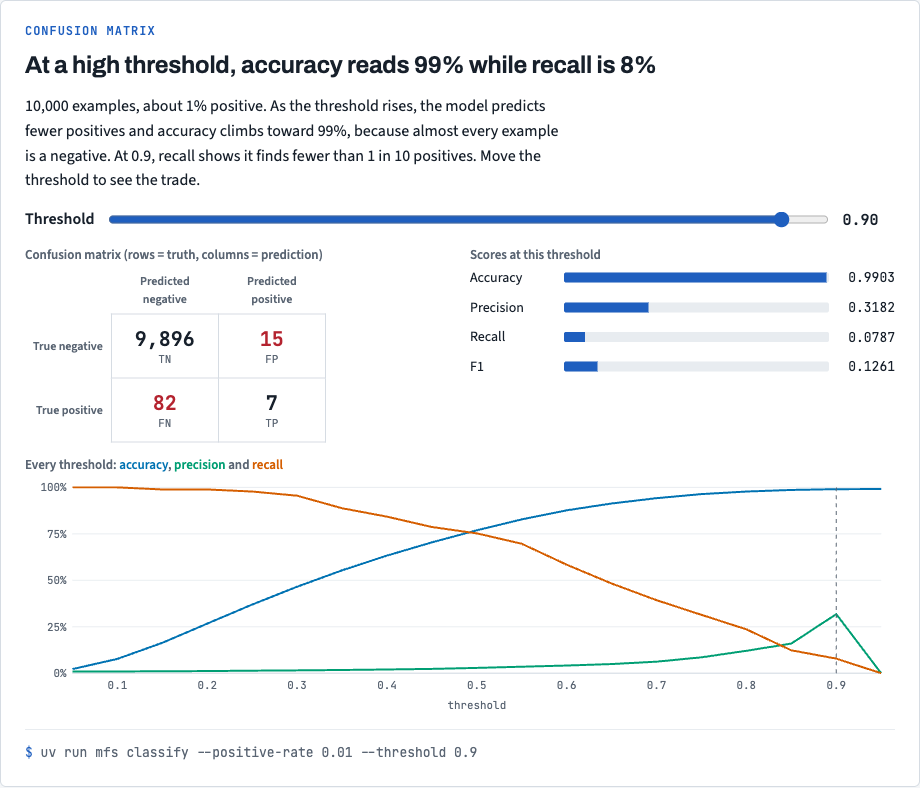
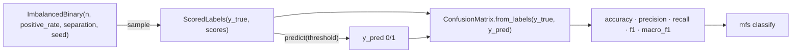

# Stack 1/7: synthetic data and the confusion matrix

**PR:** [metrics-from-scratch#1](https://github.com/bhavya94/metrics-from-scratch/pull/1) · **Code at:** `72361e2`

## Summary
Every later metric needs two things: data with a known answer, and a way to count right and wrong predictions.
This PR adds a seeded recipe for imbalanced binary data and a `ConfusionMatrix` that computes accuracy,
precision, recall, F1 and macro-F1. Each metric matches sklearn to 1e-12. The demo shows the first trap: at a 1%
positive rate, a model scores 99% accuracy while it finds 8% of the positives.

## The metric, drawn

At a 1% positive rate, accuracy climbs toward 99% as the threshold rises. At 0.9 the model finds 7 of 89 positives. The confusion matrix shows where the errors are. The chart comes from `docs/views/index.html` in the repo.

## How it works

- The recipe draws labels at the positive rate, then a latent value from N(separation, 1) for positives and
  N(0, 1) for negatives. A sigmoid centred between the classes turns it into a score ([`src/metrics_from_scratch/data/synthetic.py:39-44`](https://github.com/bhavya94/metrics-from-scratch/blob/72361e28b66edf5cb5801974e4e873bafdd4c3fb/src/metrics_from_scratch/data/synthetic.py#L39-L44)).
- `from_labels` counts each (truth, prediction) pair with one `np.add.at` call ([`src/metrics_from_scratch/classification/confusion.py:36`](https://github.com/bhavya94/metrics-from-scratch/blob/72361e28b66edf5cb5801974e4e873bafdd4c3fb/src/metrics_from_scratch/classification/confusion.py#L36)).
  Rows are the truth and columns the prediction, the same layout as sklearn.
- Every metric reads the counts. For example, F1 is 2TP / (2TP + FP + FN) ([`src/metrics_from_scratch/classification/confusion.py:63-67`](https://github.com/bhavya94/metrics-from-scratch/blob/72361e28b66edf5cb5801974e4e873bafdd4c3fb/src/metrics_from_scratch/classification/confusion.py#L63-L67)).

## Decision log

| Decision | Options considered | Chosen | Why |
|---|---|---|---|
| Shape of the metric code | Free functions on (y_true, y_pred); a class | `ConfusionMatrix` frozen dataclass | Five metrics share one state, the counts. Kappa reuses it in PR 6. |
| Zero denominators | Raise; return nan; return 0 | Return 0.0 | Matches sklearn's `zero_division=0`, so parity tests compare like with like. |
| Labels outside `labels` | Ignore them (sklearn); raise | Raise a ValueError | A judge that returns "1" as a string must fail loudly, not be dropped from the count. |
| Data | A public dataset; synthetic | Seeded synthetic recipe | The positive rate and separation become knobs, so each trap can be shown on demand. |

## Cost & risk
No runtime cost; nothing is downloaded. If a metric breaks, the parity tests catch it.

## Open questions
None.
