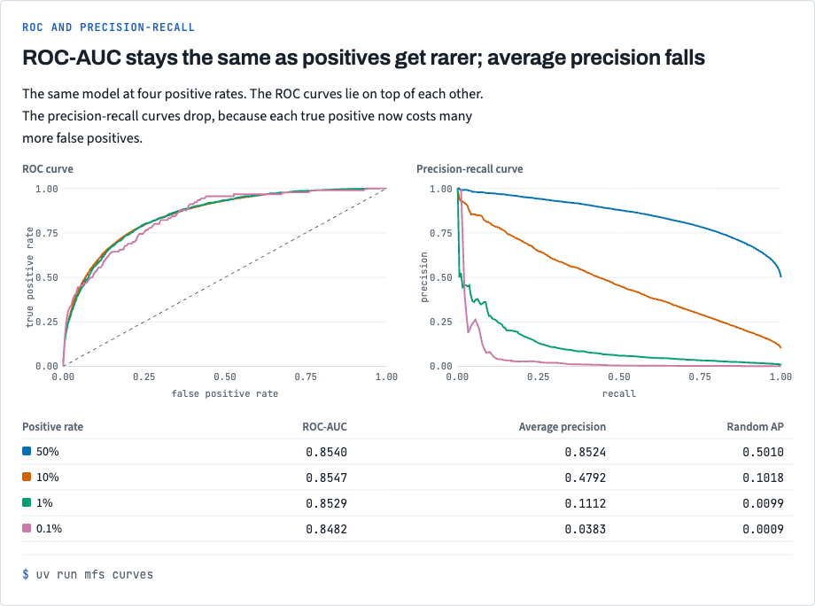
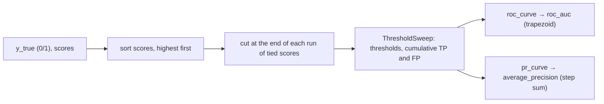

# Stack 2/7: ROC and precision-recall curves

**PR:** [metrics-from-scratch#2](https://github.com/bhavya94/metrics-from-scratch/pull/2) · **Code at:** `d11d297`

## Summary
Point metrics need a threshold. Ranking metrics score the whole ordering instead. This PR adds a
`ThresholdSweep` that both curves read from. It gives ROC-AUC and average precision, and both match sklearn to
1e-12. The demo shows the second trap: as positives get rarer, ROC-AUC stays at about 0.85, while average
precision falls toward the positive rate.

## The metric, drawn

The four ROC curves lie on top of each other. The precision-recall curves drop as positives get rarer. Average precision tracks that drop, and ROC-AUC does not. The chart comes from `docs/views/index.html` in the repo.

## How it works

- `from_scores` sorts once, then cuts at the last index of each run of tied scores ([`src/metrics_from_scratch/classification/curves.py:38`](https://github.com/bhavya94/metrics-from-scratch/blob/d11d2977e683b7cf7db7bba6d6a66978881c8927/src/metrics_from_scratch/classification/curves.py#L38)).
  Tied examples therefore enter the positive set together. That keeps ROC-AUC equal to the pairwise
  probability, where ties count one half.
- ROC-AUC is the trapezoid area ([`src/metrics_from_scratch/classification/curves.py:48-54`](https://github.com/bhavya94/metrics-from-scratch/blob/d11d2977e683b7cf7db7bba6d6a66978881c8927/src/metrics_from_scratch/classification/curves.py#L48-L54)). A test checks it against brute-force
  pair counting.
- Average precision is a step sum, not a trapezoid ([`src/metrics_from_scratch/classification/curves.py:61-68`](https://github.com/bhavya94/metrics-from-scratch/blob/d11d2977e683b7cf7db7bba6d6a66978881c8927/src/metrics_from_scratch/classification/curves.py#L61-L68)). Straight lines between
  PR points overstate the area.

## Decision log

| Decision | Options considered | Chosen | Why |
|---|---|---|---|
| Structure | Four functions, each re-sorting | One `ThresholdSweep` object | Both curves and both areas share the same sorted counts. |
| PR area | Trapezoid; step sum | Step sum (average precision) | It is sklearn's definition, and the trapezoid is optimistic. |
| Invalid input | Pass it through; raise | Raise for labels other than 0/1, and for NaN or infinite scores | Labels {1, 2} gave a silent ROC-AUC of 0.33. Tied −inf scores were split apart by mistake. |
| Intermediate ROC points | Drop collinear points (sklearn default) | Keep every threshold | Simpler, and the area is the same. Parity uses `drop_intermediate=False`. |

## Cost & risk
One sort, O(n log n). The demo runs 4 × 100,000 examples in under a second.

## Open questions
None.
