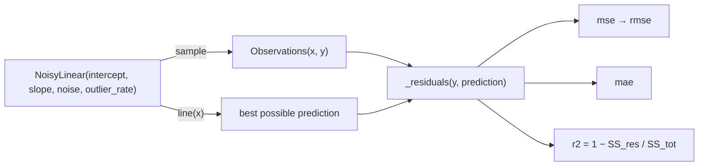

# Stack 3/7: regression metrics

**PR:** [metrics-from-scratch#3](https://github.com/bhavya94/metrics-from-scratch/pull/3) · **Code at:** `3ae233d`

## Summary
This PR adds MSE, RMSE, MAE and R2, with a delivery-time data recipe that can add one-sided outliers. All four
match sklearn, including its conventions for a constant target and for a single example. The demo shows that
delaying 2% of deliveries by an hour makes MSE 5 times larger, but moves MAE by about one minute. R2 is 0 for
predicting the mean and negative for anything worse.

## How it works

- Every metric goes through `_residuals`, which checks the shapes and rejects empty input ([`src/metrics_from_scratch/regression/metrics.py:8-14`](https://github.com/bhavya94/metrics-from-scratch/blob/3ae233db3682bcb8e3249896a744a2688caa2e32/src/metrics_from_scratch/regression/metrics.py#L8-L14)).
- `r2` handles the two undefined cases the way sklearn does: nan for one example, and 1.0 or 0.0 for a constant
  target ([`src/metrics_from_scratch/regression/metrics.py:40-46`](https://github.com/bhavya94/metrics-from-scratch/blob/3ae233db3682bcb8e3249896a744a2688caa2e32/src/metrics_from_scratch/regression/metrics.py#L40-L46)).

## Decision log

| Decision | Options considered | Chosen | Why |
|---|---|---|---|
| Shape | A class; functions | Pure functions | Stateless math: the conventions keep it as functions. |
| Edge cases | Raise; match sklearn | Match sklearn | The parity tests stay one-to-one, and the docstring states each case. |
| Outliers | Symmetric noise; one-sided delays | One-sided delays | Real delivery delays only go one way, and that skew is what pulls MSE. |

## Cost & risk
None.

## Open questions
None.
