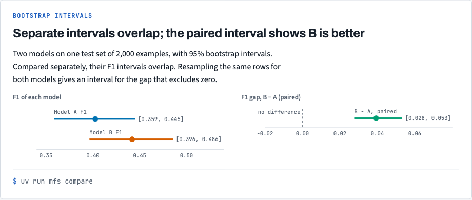
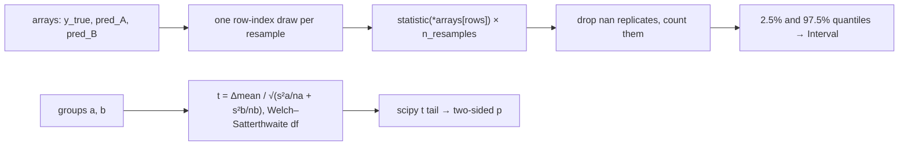

# Stack 4/7: bootstrap confidence intervals and Welch's t-test

**PR:** [metrics-from-scratch#4](https://github.com/bhavya94/metrics-from-scratch/pull/4) · **Code at:** `453ad9f`

## Summary
A single score can't say whether one model beats another. This PR adds a percentile `Bootstrap` that works for
any statistic and resamples paired arrays with the same rows. It also adds Welch's two-sample t-test. In the demo,
two models' separate F1 intervals overlap, but the paired interval of their difference excludes 0. A simulated
A/B test with a real 1-minute lift gets p = 0.43, which sets up the power analysis in PR 5.

## The metric, drawn

The separate F1 intervals of models A and B overlap. The paired interval of the gap, B minus A, excludes zero. The chart comes from `docs/views/index.html` in the repo.

## How it works

- `interval` draws one set of row indices per resample and applies it to every array ([`src/metrics_from_scratch/stats/bootstrap.py:47`](https://github.com/bhavya94/metrics-from-scratch/blob/453ad9f7022cee1352efc6fa374002f1a7e02311/src/metrics_from_scratch/stats/bootstrap.py#L47)).
  That is what pairs model A and model B on the same examples. It removes the shared noise from the difference.
- Replicates where the statistic is undefined are dropped and counted ([`src/metrics_from_scratch/stats/bootstrap.py:48`](https://github.com/bhavya94/metrics-from-scratch/blob/453ad9f7022cee1352efc6fa374002f1a7e02311/src/metrics_from_scratch/stats/bootstrap.py#L48)). Without that,
  one resample with a single label turned a kappa interval into nan (found in review).
- `welch_t_test` computes the statistic and the degrees of freedom itself ([`src/metrics_from_scratch/stats/hypothesis.py:33`](https://github.com/bhavya94/metrics-from-scratch/blob/453ad9f7022cee1352efc6fa374002f1a7e02311/src/metrics_from_scratch/stats/hypothesis.py#L33)). It looks up
  only the t distribution's tail in scipy ([`src/metrics_from_scratch/stats/hypothesis.py:35`](https://github.com/bhavya94/metrics-from-scratch/blob/453ad9f7022cee1352efc6fa374002f1a7e02311/src/metrics_from_scratch/stats/hypothesis.py#L35)), as you would read a printed table.

## Decision log

| Decision | Options considered | Chosen | Why |
|---|---|---|---|
| Interval method | Percentile; BCa; normal | Percentile | It is the simplest one to explain. The README's limits section says when BCa is better. |
| Pairing | A separate CI for each model; paired resampling | Paired resampling across all arrays | Model comparisons on one test set are paired. Separate CIs hide real gaps. |
| t distribution | Write an incomplete-beta CDF; scipy | scipy for the tail only | The CDF is a lookup, not the idea being learned. scipy becomes a runtime dependency. |
| Memory | Build the full index matrix | One resample at a time | The matrix needs about 16 GB at n = 1e6. Same random stream, same numbers. |
| A/B data | Generate in the CLI; a data recipe | `TwoArms` recipe in `data/` | Keeps data generation out of the CLI, like the other recipes. |

## Cost & risk
The bootstrap costs n_resamples × the statistic's cost. The demo's 1,000 resamples of F1 on 2,000 rows take
about 1 s.

## Open questions
None.
