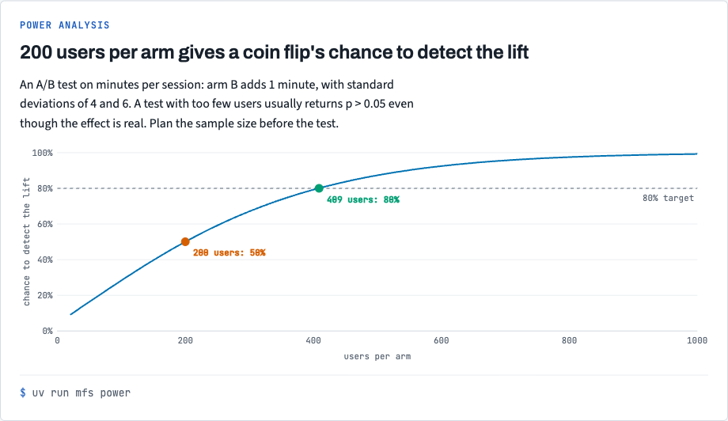
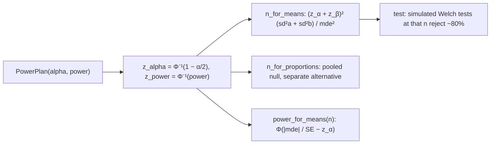

# Stack 5/7: power analysis

**PR:** [metrics-from-scratch#5](https://github.com/bhavya94/metrics-from-scratch/pull/5) · **Code at:** `c2fa77a`

## Summary
PR 4's A/B test missed a real effect. This PR explains why before a test runs. `PowerPlan` holds alpha and
power, and it gives users per arm for a difference in means or in conversion rates, plus the power at a given n.
The PR 4 design had 50% power; it needed 409 users per arm. A conversion move from 10% to 12% needs 3,841 per arm.

## The metric, drawn

With 200 users per arm, the test detects the 1-minute lift half the time. It needs 409 users per arm for 80%. The chart comes from `docs/views/index.html` in the repo.

## How it works

- `n_for_means` is the textbook normal-approximation formula ([`src/metrics_from_scratch/stats/power.py:33-39`](https://github.com/bhavya94/metrics-from-scratch/blob/c2fa77aef682376d756f30cb5fbd2e3527c06c34/src/metrics_from_scratch/stats/power.py#L33-L39)).
- `n_for_proportions` uses the pooled rate under the null and each arm's own variance under the alternative
  ([`src/metrics_from_scratch/stats/power.py:47-59`](https://github.com/bhavya94/metrics-from-scratch/blob/c2fa77aef682376d756f30cb5fbd2e3527c06c34/src/metrics_from_scratch/stats/power.py#L47-L59)). It gives 3,841 for 10% → 12%, the standard textbook value.
- No library computes these exact formulas, so the tests check them by simulation. They run 1,000 Welch tests at
  the planned n and confirm that about 80% reject.

## Decision log

| Decision | Options considered | Chosen | Why |
|---|---|---|---|
| Shape | Free functions with alpha and power arguments; a class | `PowerPlan` frozen dataclass | Three methods share the same two settings. |
| Normal quantiles | scipy; the stdlib | `statistics.NormalDist` | The stdlib is enough. |
| Proof | Compare with statsmodels; simulate | Simulate | statsmodels uses a different effect-size scale. A simulation tests the claim itself. |

## Cost & risk
The two simulation tests take about 0.5 s.

## Open questions
None.
