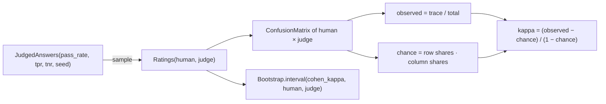

# Stack 6/7: Cohen's kappa for judge-vs-human agreement

**PR:** [metrics-from-scratch#6](https://github.com/bhavya94/metrics-from-scratch/pull/6) · **Code at:** `93f9dba`

## Summary
An LLM judge is a classifier, and its agreement with a human has the same imbalance trap as accuracy. This PR
adds `cohen_kappa`, built on the confusion matrix, and a `JudgedAnswers` recipe that makes a judge from its
true positive and true negative rates. In the demo, a judge that passes everything agrees 72% of the time but has
kappa 0. A careful judge reaches kappa 0.81, with a bootstrap interval.

## How it works

- Chance agreement is the dot product of the two raters' label shares ([`src/metrics_from_scratch/agreement/kappa.py:21`](https://github.com/bhavya94/metrics-from-scratch/blob/93f9dba41b5f0de953882d63160d26e4744e2305/src/metrics_from_scratch/agreement/kappa.py#L21)). When both use
  one label, chance is 1 and kappa is nan, as in sklearn ([`src/metrics_from_scratch/agreement/kappa.py:22-23`](https://github.com/bhavya94/metrics-from-scratch/blob/93f9dba41b5f0de953882d63160d26e4744e2305/src/metrics_from_scratch/agreement/kappa.py#L22-L23)).
- The recipe passes a human-passed answer with probability TPR. It fails a human-failed one with probability
  TNR ([`src/metrics_from_scratch/data/synthetic.py:139`](https://github.com/bhavya94/metrics-from-scratch/blob/93f9dba41b5f0de953882d63160d26e4744e2305/src/metrics_from_scratch/data/synthetic.py#L139)). The demo's three judges are three (TPR, TNR) pairs on the same human labels.
- The CLI reports how many resamples were undefined ([`src/metrics_from_scratch/cli.py:105`](https://github.com/bhavya94/metrics-from-scratch/blob/93f9dba41b5f0de953882d63160d26e4744e2305/src/metrics_from_scratch/cli.py#L105)). On small, skewed label sets this number is
  not zero.

## Decision log

| Decision | Options considered | Chosen | Why |
|---|---|---|---|
| Where kappa lives | A method on ConfusionMatrix; its own layer | An `agreement` package above `classification` | Agreement is a separate idea; the layer test allows it to import `classification`. |
| Judge model | Random label flips; (TPR, TNR) | (TPR, TNR) | Those are the two numbers to report next to kappa, so the demo uses them as the inputs. |
| Report | Kappa alone; kappa + TPR + TNR + CI | All four | Kappa depends on prevalence. TPR and TNR show which way a judge errs. |

## Cost & risk
None beyond the bootstrap (PR 4).

## Open questions
None.
