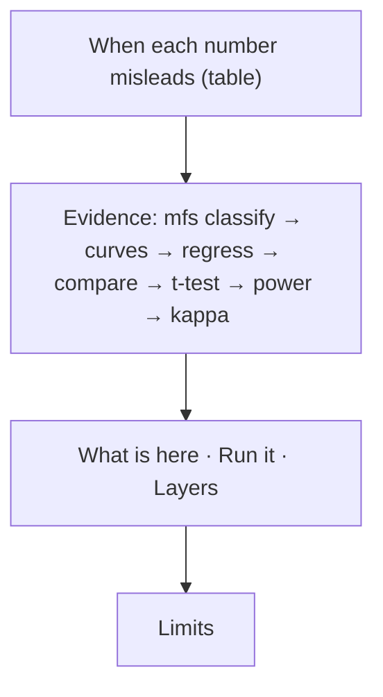

# Stack 7/7: writeup, when each number misleads

**PR:** [metrics-from-scratch#7](https://github.com/bhavya94/metrics-from-scratch/pull/7) · **Code at:** `07e304c`

## Summary
The README now leads with the answer: a table that maps each number to the condition that fools it and what to
check instead. The command outputs from PRs 1–6 follow as evidence, in run order. A limits section closes it:
synthetic data, normal approximations, the percentile bootstrap, peeking, and kappa's dependence on prevalence.

## How it works

## Decision log

| Decision | Options considered | Chosen | Why |
|---|---|---|---|
| Where the writeup lives | A separate docs page; the README | The README | One page for a newcomer: the answer first, then the method, then the limits. |
| Limits | Leave them out; list them | List them | Each one names the case where a method here gives the wrong answer. |

## Cost & risk
Documentation only.

## Open questions
None.
