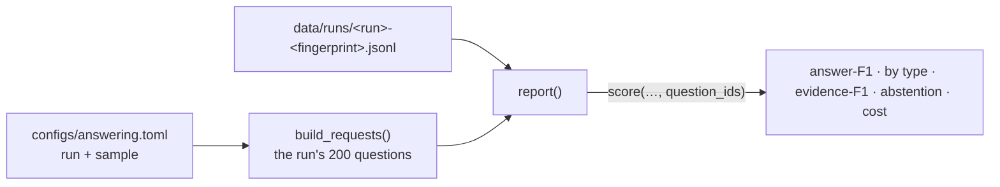

# M1 results: one-shot and closed-book baselines

**PR:** [reflective-qa#11](https://github.com/bhavya94/reflective-qa/pull/11) · **Code at:** [`adda648`](https://github.com/bhavya94/reflective-qa/tree/adda64835b49c79bd72472b294dcab98cf864763)

## Summary
M1 measured how well a model answers questions about research papers in one shot, before any reflection. On 200
text-only dev questions, Claude Sonnet 5.5 with 20 retrieved paragraphs scores answer-F1 0.512. The same model with no
paragraphs scores 0.274, and Claude Haiku 5.5 with 5 paragraphs scores 0.425. All of M1, pilot included, cost $1.25 of
the $20 budget. This PR adds the `report` command that produces these numbers and puts them in the README.

## Results

| Run | Answer-F1 | Evidence-F1 | Says "Unanswerable" | Output tokens | Cost |
|---|---|---|---|---|---|
| Sonnet 5.5, top 20 paragraphs | 0.512 | 0.621 | 16.0% | 67 | $0.95 |
| Sonnet 5.5, closed-book | 0.274 | — | 18.0% | 61 | $0.17 |
| Haiku 5.5, top 5 paragraphs | 0.425 | 0.415 | 29.5% | 117 | $0.02 |

By answer type (answer-F1):

| Run | Extractive | Abstractive | Yes/no | Unanswerable |
|---|---|---|---|---|
| Sonnet 5.5, 20 paragraphs | 0.489 | 0.404 | 0.474 | 0.826 |
| Sonnet 5.5, closed-book | 0.189 | 0.264 | 0.619 | 0.474 |
| Haiku 5.5, 5 paragraphs | 0.401 | 0.327 | 0.350 | 0.773 |

29 of the 200 questions (14.5%) have an annotator who marked them unanswerable.

## What the numbers say
1. **Retrieval matters.** Paragraphs add 0.238 answer-F1 over closed-book. The search step from M1 part 1 is worth it.
2. **The model knows something about these papers already.** Closed-book scores 0.274. Part of it is guessing: on
   yes/no questions, a guess is right about half the time. Extractive closed-book answers score 0.189, which is low but
   not zero.
3. **The weak writer is weak in the intended way.** Haiku with 5 paragraphs scores 0.087 below Sonnet with 20, and it
   gives M2 more errors to study.

## Leads for M2's error analysis
These are patterns in 200 answers, not conclusions. M2 should confirm or reject them by reading outputs.
1. **Abstaining on yes/no questions.** On the 17 questions where every annotator answered plainly yes or no, Sonnet with
   paragraphs said "Unanswerable" 6 times and Haiku 9 times; closed-book never did. When the paragraphs don't state the
   answer outright, the model abstains, and a yes/no answer would often have scored.
2. **Over-abstention in general.** Haiku says "Unanswerable" on 29.5% of questions, twice the annotator rate.
3. **Long answers.** Sonnet's answers are a median 2.0 times the length of the shortest annotator answer, which lowers
   token F1 even when the content is right.

## How it works

- **Sample-restricted scoring** ([`src/reflective_qa/scoring.py:70`](https://github.com/bhavya94/reflective-qa/blob/adda64835b49c79bd72472b294dcab98cf864763/src/reflective_qa/scoring.py#L70)): `score()` can take a set of question IDs. Without
  it, the 641 text-only questions outside the sample would count as zeros.
- **Report** ([`src/reflective_qa/baselines.py:136-142`](https://github.com/bhavya94/reflective-qa/blob/adda64835b49c79bd72472b294dcab98cf864763/src/reflective_qa/baselines.py#L136-L142)): reads the run's answer file for its current fingerprint and
  scores it on that run's own sample. It makes no API calls.

## Decision log

| Decision | Options considered | Chosen | Why | Revisit if |
|---|---|---|---|---|
| Where results live | A results file in the repo; the README; only the explainer | The README table, reproducible with `report` | Run outputs stay out of git (`data/` is ignored); the README is the public front page | Results need versioning across many runs: then a results file |
| Sample size | 200; all 841 | 200 | Fits the $20 budget across M1–M4. With measured output tokens, all 841 would cost about $4.70 for M1 alone | A narrow comparison needs more questions to separate |

## Cost & risk
- M1 total: $1.25 (pilot $0.12, full runs $1.14), against an estimate of $2.00 with assumed output tokens.
- 200 questions give wide error bars, especially per answer type (19 to 34 questions for each type except extractive, which has about 125). Differences under about
  0.05 answer-F1 should not be read as real.
- Answer-F1 rewards word overlap. Correct but differently worded answers score low, which is why M2 reads outputs by hand.

## Open questions
1. **M2 next:** error analysis. You read about 100 outputs (Sonnet and Haiku), name what goes wrong, and label each
   failure mode Pass or Fail. A small labeling tool would make this faster; it needs no API calls.
