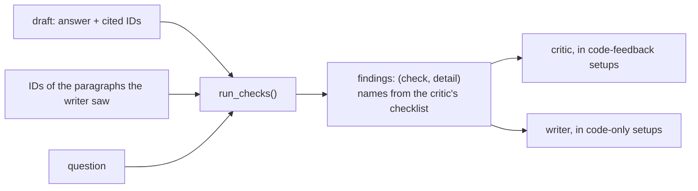

# M2, part 1: code checks on a draft answer

**PR:** [reflective-qa#12](https://github.com/bhavya94/reflective-qa/pull/12) (Stack 1/3) · **Code at:** [`f5d6266`](https://github.com/bhavya94/reflective-qa/tree/f5d6266dbdff58be02109173c815d8ca671de1e1)

## Summary
The reflection agent's critic and writer work better with external evidence than with self-review alone (Agentic AI,
Module 2). This PR adds free, deterministic checks on a draft answer. Their findings are hints: the critic confirms or
rejects them, and in the code-feedback setups they go straight to the writer. On the 200 M1 drafts, only the length
check fires more than once: 15 Sonnet drafts and 1 Haiku draft.

## In plain words
1. **Citations:** an answer must cite paragraphs it was given, an answer should cite something, and an "Unanswerable"
   answer should cite nothing.
2. **Yes/no format:** a question that starts with "is", "do", "can" and the like, and offers no "or", should be answered
   Yes or No. The hint says "if it is", because 18% of such questions on train aren't plain yes/no.
3. **Length:** more than 35 words gets "use the shortest phrase". About 1 in 10 good annotator answers is that long.
4. **No findings for empty or closed-book answers:** there is nothing to give feedback on, or nothing to cite.

## How it works

- **Yes/no detector** ([`src/reflective_qa/checks.py:16`](https://github.com/bhavya94/reflective-qa/blob/f5d6266dbdff58be02109173c815d8ca671de1e1/src/reflective_qa/checks.py#L16), [`checks.py:25-27`](https://github.com/bhavya94/reflective-qa/blob/f5d6266dbdff58be02109173c815d8ca671de1e1/src/reflective_qa/checks.py#L25-L27)): an auxiliary verb at the start, and no " or ".
- **Checks** ([`checks.py:30-50`](https://github.com/bhavya94/reflective-qa/blob/f5d6266dbdff58be02109173c815d8ca671de1e1/src/reflective_qa/checks.py#L30-L50)): empty answers return nothing ([`checks.py:34`](https://github.com/bhavya94/reflective-qa/blob/f5d6266dbdff58be02109173c815d8ca671de1e1/src/reflective_qa/checks.py#L34)); citation checks run only when paragraphs were
  given ([`checks.py:38`](https://github.com/bhavya94/reflective-qa/blob/f5d6266dbdff58be02109173c815d8ca671de1e1/src/reflective_qa/checks.py#L38)).

## On the M1 drafts (dev, 200 questions)

| Writer | Findings | Content answers flagged: answer-F1 | Not flagged |
|---|---|---|---|
| Sonnet 5.5, 20 paragraphs | 15 too long, 1 abstention citing paragraphs | 0.316 (n = 15) | 0.494 (n = 141) |
| Haiku 5.5, 5 paragraphs | 1 too long | 0.186 (n = 1) | 0.472 (n = 129) |

"Content answers" leaves out Unanswerable, Yes and No, which the length check can't flag. The table describes the
drafts; it does not show that the checks help. M3 measures that.

## Decision log

| Decision | Options considered | Chosen | Why | Revisit if |
|---|---|---|---|---|
| Where thresholds come from | Dev; train | Train | Dev is what we evaluate on. On train the yes/no detector has 0.82 precision and 0.97 recall | — |
| Word limit | 30 (all answers); 35 (content answers) | 35 | Yes/No/Unanswerable answers made up a quarter of the first base and are exempt from the check. 10.1% of content answers exceed 35 | Revisions get cut too short |
| Abstention that cites paragraphs | "The answer may be there" hint; neutral citation hint | Neutral | The first version's only M1 hit was a correct abstention; the hint would have pushed the writer off it. Caught in review | — |
| Keep checks that never fired on M1 | Drop them; keep them | Keep | They cost nothing and guard against invented citations and wordy yes/no answers; revisions could produce both | They still never fire after M3 |

## Cost & risk
- No model calls. The report runs in a few seconds.
- The checks only hint. A false alarm can still lead to a worse revision, which M3 counts.
- Because only the length check fires, the code-feedback setups in M3 mostly test "shorten long answers". For Haiku
  they will revise just one draft.

## Open questions
None for this PR.
