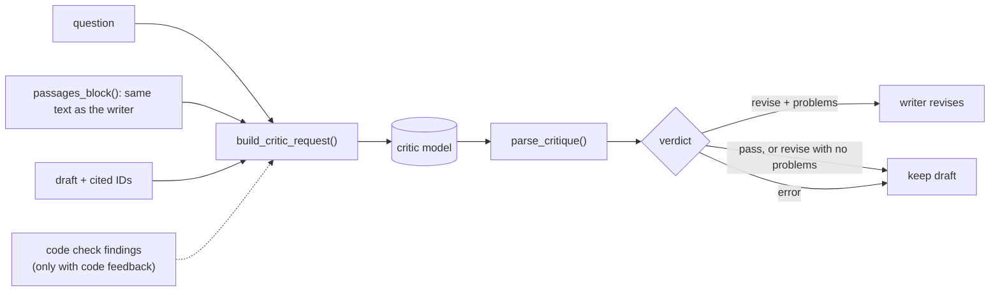

# M2, part 2: the critic

**PR:** [reflective-qa#13](https://github.com/bhavya94/reflective-qa/pull/13) (Stack 2/4) · **Code at:** [`3355653`](https://github.com/bhavya94/reflective-qa/tree/3355653877e3c0a9176e50806d1033aa1926c623)

## Summary
The critic is the reflection agent's reviewer. It reads the question, the same paragraphs the writer saw, and the
draft with its citations. It then passes the draft or lists problems from a fixed checklist, so the writer knows
exactly what to fix. In code-feedback setups it also sees the code checks' findings, with an instruction to confirm or
reject each one. This PR builds the request and parses the reply; it makes no model calls.

## In plain words
1. **Same view as the writer.** The critic gets the exact paragraph text the writer got, so it judges the draft on
   the same evidence.
2. **A fixed checklist.** Seven named problems, from "a claim isn't in the cited passages" to "a yes/no question isn't
   answered Yes or No". The reply schema only accepts those names, so the critic can't invent new categories.
3. **Actionable detail.** Each problem says what to change and names the passage that shows it, when there is one.
4. **Safe failure.** If the critic refuses, runs out of tokens or returns broken JSON, the draft is kept unchanged.

## How it works

- **Checklist** ([`src/reflective_qa/critic.py:12-20`](https://github.com/bhavya94/reflective-qa/blob/3355653877e3c0a9176e50806d1033aa1926c623/src/reflective_qa/critic.py#L12-L20)) and **prompt** ([`critic.py:22-31`](https://github.com/bhavya94/reflective-qa/blob/3355653877e3c0a9176e50806d1033aa1926c623/src/reflective_qa/critic.py#L22-L31)), built from the checklist.
- **Schema** ([`critic.py:33-48`](https://github.com/bhavya94/reflective-qa/blob/3355653877e3c0a9176e50806d1033aa1926c623/src/reflective_qa/critic.py#L33-L48)): `check` must be one of the checklist names.
- **Request** ([`critic.py:70-84`](https://github.com/bhavya94/reflective-qa/blob/3355653877e3c0a9176e50806d1033aa1926c623/src/reflective_qa/critic.py#L70-L84)): findings are added only when `code_feedback` is on ([`critic.py:75`](https://github.com/bhavya94/reflective-qa/blob/3355653877e3c0a9176e50806d1033aa1926c623/src/reflective_qa/critic.py#L75)).
- **Parsing** ([`critic.py:87-99`](https://github.com/bhavya94/reflective-qa/blob/3355653877e3c0a9176e50806d1033aa1926c623/src/reflective_qa/critic.py#L87-L99)): "revise" with no problems counts as pass, because it gives the writer nothing to act on.
- **Shared formatting** ([`src/reflective_qa/answering.py:58-60`](https://github.com/bhavya94/reflective-qa/blob/3355653877e3c0a9176e50806d1033aa1926c623/src/reflective_qa/answering.py#L58-L60)): `passages_block()` now builds the passage list
  for both prompts. The writer's prompt is byte-identical to before on all 600 M1 requests.

## Decision log

| Decision | Options considered | Chosen | Why | Revisit if |
|---|---|---|---|---|
| Critic output | Free text; a score; a verdict plus named problems | Verdict plus named problems | The writer needs specific fixes, and named problems can be counted in the results | — |
| Checklist source | Human error analysis (M2 as first planned); M1 leads plus general QA faults | M1 leads plus general faults | Scope narrowed to the online critic on 2026-10-11; labeled error analysis moves to a future offline-eval project | That project finds failure modes the checklist misses |
| Findings shown to the critic | Always; never; per setup | Per setup | The experiment compares critics with and without code feedback | — |
| "Revise" with no problems | Revise anyway; count as pass | Pass | Nothing to act on; a blind revision would add noise | — |

## Cost & risk
- No model calls in this PR. A review costs about 4,400 input tokens for a 20-paragraph draft and 1,900 for a
  5-paragraph draft (counted free). The pilot measured 49 to 90 output tokens per review.
- A critic can be wrong. Wrong "revise" verdicts lead to worse answers, which the experiment counts.

## Open questions
None for this PR.
