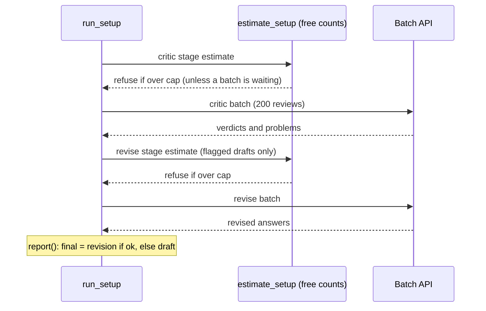

# M2, part 4: running reflection with budget guards, and the report

**PR:** [reflective-qa#15](https://github.com/bhavya94/reflective-qa/pull/15) (Stack 4/4) · **Code at:** [`9487bb0`](https://github.com/bhavya94/reflective-qa/tree/9487bb042e029868e709c8ba5c92a72e6cd8e803)

## Summary
This PR runs the reflection agent. For each setup, a critic batch reviews all 200 drafts, then a revise batch
rewrites the flagged ones. Both stages reuse M1's never-pay-twice runner, and each is estimated with free token
counts and refused if its estimate is over the dollar cap. The report scores final answers exactly like M1, and shows
what reflection did: critic verdicts, revisions, and how many answers got better or worse. The full experiment ran on
2026-10-11 for $2.29.

## In plain words
1. **Two stages, two batches.** The critic stage runs first. Only drafts with problems go to the revise stage, so its
   cost is known exactly before it is spent.
2. **Guards per stage.** A stage over the cap stops before anything is submitted. A batch that is already paid for
   is always collected.
3. **Estimates learn.** Once a stage has results, its estimate uses measured token counts, not assumptions.
4. **The final answer** is the revision if one succeeded, else the draft. The report adds the cost of reflecting only.

## How it works

- **Records** ([`src/reflective_qa/reflection.py:136-142`](https://github.com/bhavya94/reflective-qa/blob/9487bb042e029868e709c8ba5c92a72e6cd8e803/src/reflective_qa/reflection.py#L136-L142)): critiques keep token counts, so estimates can use them.
- **Final answers and report** ([`reflection.py:152-183`](https://github.com/bhavya94/reflective-qa/blob/9487bb042e029868e709c8ba5c92a72e6cd8e803/src/reflective_qa/reflection.py#L152-L183)): better and worse compare answer-F1 per question, over answers that
  actually changed.
- **Estimate and run** ([`reflection.py:196-229`](https://github.com/bhavya94/reflective-qa/blob/9487bb042e029868e709c8ba5c92a72e6cd8e803/src/reflective_qa/reflection.py#L196-L229)): the guards are at [`reflection.py:221`](https://github.com/bhavya94/reflective-qa/blob/9487bb042e029868e709c8ba5c92a72e6cd8e803/src/reflective_qa/reflection.py#L221) and [`reflection.py:227`](https://github.com/bhavya94/reflective-qa/blob/9487bb042e029868e709c8ba5c92a72e6cd8e803/src/reflective_qa/reflection.py#L227).

## Results (200 questions)

| Setup | Answer-F1 | Revised | Better / worse | Cost |
|---|---|---|---|---|
| Sonnet code feedback | 0.512 → 0.520 | 16 | 8 / 7 | $0.09 |
| Sonnet self-critique | 0.512 → 0.506 | 37 | 14 / 17 | $1.23 |
| Haiku code feedback | 0.425 → 0.426 | 1 | 1 / 0 | $0.00 |
| Haiku self-critique | 0.425 → 0.419 | 39 | 14 / 9 | $0.03 |
| Haiku, Sonnet critic | 0.425 → 0.421 | 59 | 23 / 23 | $0.47 |
| Haiku, Sonnet critic + checks | 0.425 → 0.441 | 53 | 26 / 15 | $0.47 |

The results PR explains what these numbers mean.

## Decision log

| Decision | Options considered | Chosen | Why | Revisit if |
|---|---|---|---|---|
| Stage order | Critic and revise in one request; two batches | Two batches | Revise cost is known exactly before it is spent, and only flagged drafts pay for it | Rounds beyond one |
| Where run logic lives | In `main()`; in functions | Functions | The guards could only be tested after the move. Caught in review: 9 of 13 mutations survived before | — |
| A revision that fails | Count it as an empty answer; keep the draft | Keep the draft | Reflection should never make an answer disappear | — |

## Cost & risk
- The run cost $2.29 for six setups. Sonnet reviewing its own 20-paragraph drafts was $1.23 of it.
- No critic errors and no failed revisions on 800 reviews and 205 revisions.

## Open questions
None for this PR.
