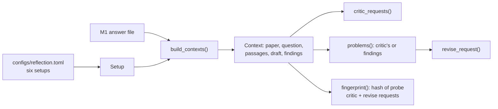

# M2, part 3: reflection setups, context, and the critic and revise requests

**PR:** [reflective-qa#14](https://github.com/bhavya94/reflective-qa/pull/14) (Stack 3/4) · **Code at:** [`473d278`](https://github.com/bhavya94/reflective-qa/tree/473d27835b9295e523cf0b0aa4cc4a1e6d189224)

## Summary
This PR turns the checks and the critic into experiment setups. Each setup reuses one M1 run's answers as first
drafts, so every comparison with M1 is on the same questions and drafts. For each question it gathers what the writer
saw, its draft, and the check findings. From that it builds the critic's request and, for drafts with problems, the
revision request. It makes no model calls; part 4 runs the stages.

## In plain words
1. **Six setups.** Code feedback only, and self-critique, each for both writers. Then the Sonnet critic for Haiku,
   with and without the check findings. The last pair turned out to be near-replicates, since the checks flag
   almost no Haiku drafts, so their gap measures noise.
2. **Who decides what to fix.** With a critic, the writer fixes the critic's problems. Without one, it fixes the
   check findings directly.
3. **The revision request** is the writer's original prompt plus its draft and the list of problems, so the writer
   revises with the same evidence and rules.
4. **Separate files per setup.** Each setup's files are named with a fingerprint of the real requests it sends. Change a
   prompt, and new files start, so answers from different versions never mix.

## How it works

- **Revise instruction** ([`src/reflective_qa/reflection.py:20`](https://github.com/bhavya94/reflective-qa/blob/473d27835b9295e523cf0b0aa4cc4a1e6d189224/src/reflective_qa/reflection.py#L20)): restates the writer's answer rules. The 20-question
  pilot showed revisions drifting long and hedged (Haiku revisions averaged 307 output tokens, against 117 for drafts).
- **Fingerprint** ([`reflection.py:55-75`](https://github.com/bhavya94/reflective-qa/blob/473d27835b9295e523cf0b0aa4cc4a1e6d189224/src/reflective_qa/reflection.py#L55-L75)): hashes the actual critic and revise requests built for a fixed probe question. The word
  limit counts only for setups that show findings.
- **Contexts** ([`reflection.py:84-104`](https://github.com/bhavya94/reflective-qa/blob/473d27835b9295e523cf0b0aa4cc4a1e6d189224/src/reflective_qa/reflection.py#L84-L104)): a sampled question without a draft is an error, not a silently smaller sample.
- **Problems** ([`reflection.py:114-120`](https://github.com/bhavya94/reflective-qa/blob/473d27835b9295e523cf0b0aa4cc4a1e6d189224/src/reflective_qa/reflection.py#L114-L120)) and **revision request** ([`reflection.py:123-128`](https://github.com/bhavya94/reflective-qa/blob/473d27835b9295e523cf0b0aa4cc4a1e6d189224/src/reflective_qa/reflection.py#L123-L128)).
- **Shared runner** ([`src/reflective_qa/baselines.py:81-106`](https://github.com/bhavya94/reflective-qa/blob/473d27835b9295e523cf0b0aa4cc4a1e6d189224/src/reflective_qa/baselines.py#L81-L106)): `submit_and_collect()` holds the never-pay-twice batch
  logic; M1's `run_batch()` is now a thin wrapper ([`baselines.py:109-113`](https://github.com/bhavya94/reflective-qa/blob/473d27835b9295e523cf0b0aa4cc4a1e6d189224/src/reflective_qa/baselines.py#L109-L113)).

## Decision log

| Decision | Options considered | Chosen | Why | Revisit if |
|---|---|---|---|---|
| First drafts | Regenerate; reuse M1 answers | Reuse | No cost, and the comparison with M1 is exact | — |
| Fingerprint | Config values; prompt constants; real requests for a probe | Real probe requests | Catches any change in prompts, schemas or finding texts. Caught in review: the first version missed check logic | — |
| Critic max_tokens | 16,000; 4,000 | 4,000 | Thinking counts toward it. Caps a runaway Sonnet review at about $0.02; a cut-off review keeps the draft | Reviews get cut off |
| Revise prompt | Writer prompt + draft + problems; plus restated rules | Plus restated rules | The pilot showed hedged, long revisions. The rules are the writer's own. Decided after seeing 20 of the 200 evaluation questions, which is a small risk of tuning on the test set | — |
| The replicate pair | Drop it; keep it as a noise measure | Keep | In the pilot, two near-identical setups ended 0.075 answer-F1 apart; the full run measures that gap on 200 questions | — |

## Cost & risk
- No model calls in this PR.
- The prompt change came after the pilot, so the pilot's answers stay in their own files. Re-running the pilot's
  20 critic reviews cost about $0.17.

## Open questions
None for this PR.
