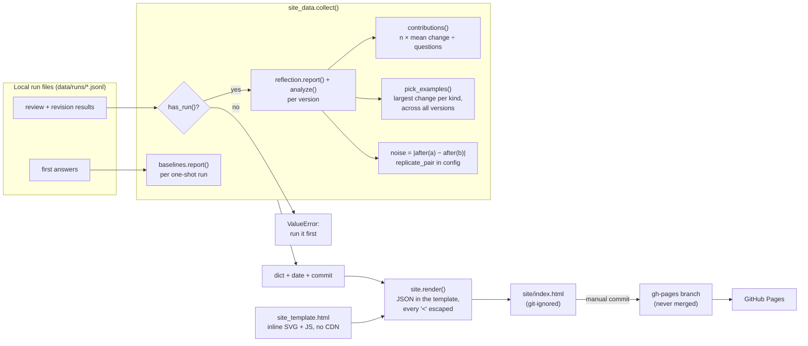

# Results page: one public page that explains the whole project

**PRs:** [reflective-qa#17](https://github.com/bhavya94/reflective-qa/pull/17) (data) ·
[reflective-qa#18](https://github.com/bhavya94/reflective-qa/pull/18) (page) · **Code at:**
[`c9dbd83`](https://github.com/bhavya94/reflective-qa/tree/c9dbd8348175650bd333bcde1b0bc67dde7d5283) ·
**Live:** https://bhavya94.github.io/reflective-qa/

## Summary
The M3 results lived in a report command, the README and a long explainer. A reader had to piece them together, and
had to know the project first. These two PRs build one public page for a reader who is new to the project. It says
what the task is, what the agent does, and what the scores mean, before it shows any result. All numbers come from
the real run files, so the page can't disagree with the report. Building it makes no API calls.

## What the page shows
1. **The answer first.** The title asks: "Does a review step make an AI agent answer research questions better?"
   The first paragraph answers: not on average, and why.
2. **The task**, with a real question and its expert answers from the sample.
3. **The agent**: four steps (search, answer, review, revise once), the reviewer's seven-item checklist, and the six
   versions of the review step. The data builds the versions table, so it can't go stale.
4. **How we score**: answer-F1 in plain words, shown on a real pair (0.25 for a long answer, 1.00 for the short one).
   Then evidence-F1, the "Unanswerable" rate, and what a 95% interval that includes zero means.
5. **Results**: four tiles, the change per version with its interval and the noise band, the change split by kind
   of revision, and the largest real example of each kind.
6. **All scores**: one row per version, with the full cost. New versions add rows.

Milestone names (M1, M2, M3) and setup slugs don't appear on the page. Bhavya's feedback on the first version was
that they "mean nothing to the reader".

## How it works

- **Data** ([`src/reflective_qa/site_data.py:44`](https://github.com/bhavya94/reflective-qa/blob/c9dbd8348175650bd333bcde1b0bc67dde7d5283/src/reflective_qa/site_data.py#L44)): `collect()` calls the same functions as the `report` commands.
  So the page and the reports can't disagree.
- **Run check** ([`src/reflective_qa/reflection.py:158`](https://github.com/bhavya94/reflective-qa/blob/c9dbd8348175650bd333bcde1b0bc67dde7d5283/src/reflective_qa/reflection.py#L158)): `has_run()` moved out of `reflection.main`, so `report` and
  the page share it. If a version has no results for the current code and config, `collect()` raises
  ([`src/reflective_qa/site_data.py:61`](https://github.com/bhavya94/reflective-qa/blob/c9dbd8348175650bd333bcde1b0bc67dde7d5283/src/reflective_qa/site_data.py#L61)). Before this fix, the page showed every answer as unchanged.
- **Contributions** ([`src/reflective_qa/site_data.py:18`](https://github.com/bhavya94/reflective-qa/blob/c9dbd8348175650bd333bcde1b0bc67dde7d5283/src/reflective_qa/site_data.py#L18)): a kind's share of the total change is its count times its
  mean change. Divide that by the number of questions. Unchanged answers add zero, so the shares add up exactly.
- **Examples** ([`src/reflective_qa/site_data.py:23`](https://github.com/bhavya94/reflective-qa/blob/c9dbd8348175650bd333bcde1b0bc67dde7d5283/src/reflective_qa/site_data.py#L23)): the same kind classifier as `analyze()`
  ([`src/reflective_qa/reflection.py:199`](https://github.com/bhavya94/reflective-qa/blob/c9dbd8348175650bd333bcde1b0bc67dde7d5283/src/reflective_qa/reflection.py#L199)). So a new "Unanswerable" is never shown as a rewording. The page adds a
  "shortened" kind: a rewording that is shorter and scores higher.
- **Noise** ([`src/reflective_qa/site_data.py:74-76`](https://github.com/bhavya94/reflective-qa/blob/c9dbd8348175650bd333bcde1b0bc67dde7d5283/src/reflective_qa/site_data.py#L74-L76)): the gap between the two versions named in `replicate_pair`.
- **Render** ([`src/reflective_qa/site.py:21`](https://github.com/bhavya94/reflective-qa/blob/c9dbd8348175650bd333bcde1b0bc67dde7d5283/src/reflective_qa/site.py#L21)): the data goes in as JSON, with every `<` written as `<`. So no
  answer text, such as `</script>` or `<!--<script>`, can change where the script ends. The JS writes all text with
  `textContent` ([`src/reflective_qa/site_template.html:139`](https://github.com/bhavya94/reflective-qa/blob/c9dbd8348175650bd333bcde1b0bc67dde7d5283/src/reflective_qa/site_template.html#L139)).
- **Charts** ([`src/reflective_qa/site_template.html:190`](https://github.com/bhavya94/reflective-qa/blob/c9dbd8348175650bd333bcde1b0bc67dde7d5283/src/reflective_qa/site_template.html#L190), [`site_template.html:214`](https://github.com/bhavya94/reflective-qa/blob/c9dbd8348175650bd333bcde1b0bc67dde7d5283/src/reflective_qa/site_template.html#L214)): inline SVG drawn by plain JS. Under 560px each
  name goes above its row ([`src/reflective_qa/site_template.html:158`](https://github.com/bhavya94/reflective-qa/blob/c9dbd8348175650bd333bcde1b0bc67dde7d5283/src/reflective_qa/site_template.html#L158)). The charts redraw on a resize or a color
  scheme change ([`src/reflective_qa/site_template.html:269-270`](https://github.com/bhavya94/reflective-qa/blob/c9dbd8348175650bd333bcde1b0bc67dde7d5283/src/reflective_qa/site_template.html#L269-L270)).
- **Cost** ([`src/reflective_qa/site_template.html:265`](https://github.com/bhavya94/reflective-qa/blob/c9dbd8348175650bd333bcde1b0bc67dde7d5283/src/reflective_qa/site_template.html#L265)): a review row's cost includes the first answers. So every row
  is the full cost of that version on 200 questions.

## Decision log

| Decision | Options considered | Chosen | Why |
|---|---|---|---|
| Who the page is for | Project insiders; a reader new to the project | A new reader | Bhavya's feedback: the first version didn't explain the task, the agent or the scores. |
| Page order | Results first; task, agent and scoring first | The answer in one paragraph, then task, agent, scoring, results | A reader needs the task and the metric to read a chart. The top paragraph still gives the answer at once. |
| Explaining answer-F1 | A formula; a made-up example; a real pair from the run | A real pair: 0.25 → 1.00 | It shows what the score rewards with real data. |
| Where the page lives | GitHub Pages; a published Artifact; `docs/` on `main` | GitHub Pages from a `gh-pages` branch | Bhavya chose public GitHub Pages. The branch keeps generated HTML off `main`, where only code, tests, configs and the README merge. |
| Where the numbers come from | A hand-made JSON file; recompute from run files | Recompute with the report functions | One source of truth. |
| A version that hasn't run | Show zeros; skip it; refuse | Refuse | Zeros look like a real result. A skipped version hides a gap. |
| Charts | Chart.js or D3 from a CDN; inline SVG | Inline SVG | No external script and no version to pin. Six rows don't need a library. |
| Phone layout | Scale down; scroll sideways; names above rows | Names above rows | Scaling made the labels 5px. Scrolling hid the data. |
| Cost column | Review cost only; full cost | Full cost | One column must mean one thing. |

Revisit the hosting choice if the page must update on every merge. A GitHub Action could build it, but it would need
the run files, which are local.

## Cost & risk
- **Cost:** building the page makes no API calls. GitHub Pages is free.
- **Staleness:** publishing is manual. The footer names the commit that built the page.
- **Numbers:** the page shows the noise as 0.019, the gap between unrounded scores. The README says 0.020, the gap
  between rounded scores.
- **Hard-coded text:** one number on the page doesn't come from the data: "14.5% of them have an expert who answered
  Unanswerable", from the README. It changes only if the sample changes.
- **Rollback:** reset `gh-pages` to the earlier commit `e58c90d`, or turn Pages off. Neither touches `main`.

## Open questions
1. **Publishing:** keep it manual, or add a GitHub Action? An Action needs the run files in the repo or a release.
2. **Next version:** a reviewer that flags only wrong abstentions and long answers. Haiku self-review would cost
   about $0.03 for 200 questions, Sonnet about $1.20. It would add rows to "All scores".
