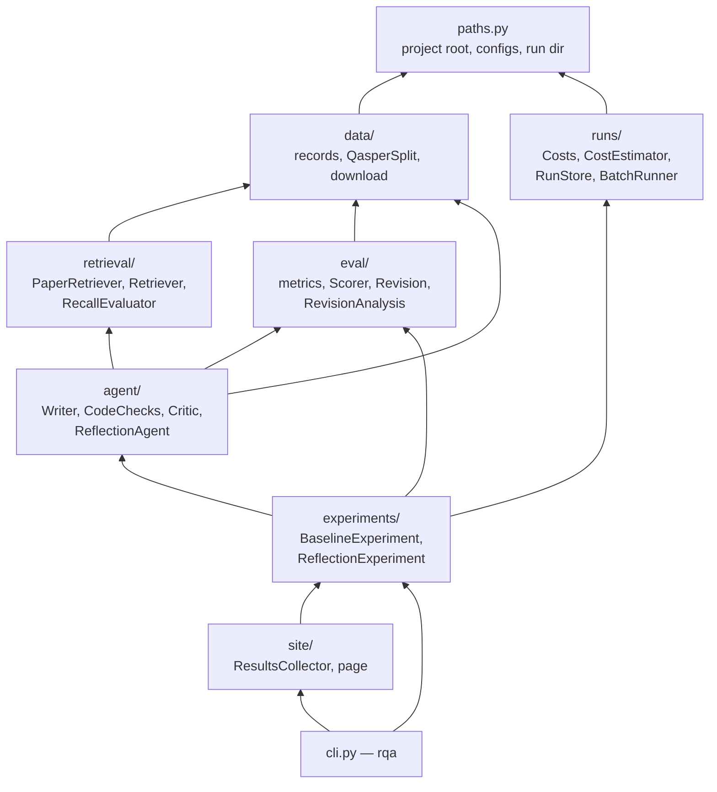
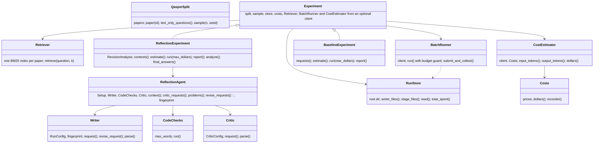
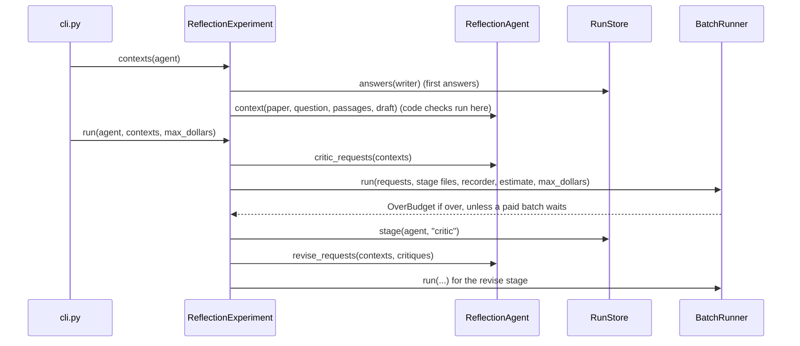

# Refactor: an object-oriented layout with one package per responsibility

**PRs:** [reflective-qa#19](https://github.com/bhavya94/reflective-qa/pull/19) ·
[#20](https://github.com/bhavya94/reflective-qa/pull/20) · [#21](https://github.com/bhavya94/reflective-qa/pull/21) ·
[#22](https://github.com/bhavya94/reflective-qa/pull/22) · [#23](https://github.com/bhavya94/reflective-qa/pull/23)
(a stack) · **Code at:** [`b22d762`](https://github.com/bhavya94/reflective-qa/tree/b22d762a52939eb39064ae6dc14c6ec99ea2973a)

## Summary
After the experiment closed, the code was 13 modules in one flat package. The flat package was not the problem. The
problem was where the logic lived: `baselines.py` held the shared Batch API runner, the cost model and the run files,
and `reflection.py` mixed four jobs. Bhavya asked for an object-oriented design with a clear module for each piece of
logic. The code now has eight packages with one-way imports, and classes that own their state. One `rqa` command
replaces nine `python -m` entry points. Behavior is unchanged: every fingerprint, all seven command outputs and the
results page match the versions saved before the refactor. No API money was spent.

## How it works

The packages, and which imports which (a test enforces it):

The classes and what each one owns:

`rqa reflect run` for one setup:

- **Data** ([`src/reflective_qa/data/qasper.py:17`](https://github.com/bhavya94/reflective-qa/blob/b22d762a52939eb39064ae6dc14c6ec99ea2973a/src/reflective_qa/data/qasper.py#L17)): `QasperSplit` owns the papers, the lookup by paper ID and the
  seeded sample. Before, four modules built the lookup and three built the sample.
- **Retrieval** ([`src/reflective_qa/retrieval/bm25.py:38`](https://github.com/bhavya94/reflective-qa/blob/b22d762a52939eb39064ae6dc14c6ec99ea2973a/src/reflective_qa/retrieval/bm25.py#L38)): `Retriever` builds one BM25 index per paper on first use.
  Three modules had a copy of that cache.
- **Agent** ([`src/reflective_qa/agent/reflection.py:45`](https://github.com/bhavya94/reflective-qa/blob/b22d762a52939eb39064ae6dc14c6ec99ea2973a/src/reflective_qa/agent/reflection.py#L45)): `ReflectionAgent` holds one setup's writer, checks and
  critic. It builds requests and reads replies, and touches no files. Its fingerprint
  ([`src/reflective_qa/agent/reflection.py:88`](https://github.com/bhavya94/reflective-qa/blob/b22d762a52939eb39064ae6dc14c6ec99ea2973a/src/reflective_qa/agent/reflection.py#L88)) hashes the same probe requests as before, so it gives the same values.
- **Runs** ([`src/reflective_qa/runs/batch.py:20`](https://github.com/bhavya94/reflective-qa/blob/b22d762a52939eb39064ae6dc14c6ec99ea2973a/src/reflective_qa/runs/batch.py#L20)): `BatchRunner` owns the one budget guard. There were three copies.
  The guard is fail-closed: `run()` ([`src/reflective_qa/runs/batch.py:24`](https://github.com/bhavya94/reflective-qa/blob/b22d762a52939eb39064ae6dc14c6ec99ea2973a/src/reflective_qa/runs/batch.py#L24)) requires an estimate and a cap.
  Over budget now raises `OverBudget`; the CLI turns it into the same message as before.
- **Records**: `ModelAnswer.to_row()` ([`src/reflective_qa/agent/writer.py:60`](https://github.com/bhavya94/reflective-qa/blob/b22d762a52939eb39064ae6dc14c6ec99ea2973a/src/reflective_qa/agent/writer.py#L60)) and `Critique.to_row()` write rows in
  the old format. `Costs.recorder()` ([`src/reflective_qa/runs/costs.py:24`](https://github.com/bhavya94/reflective-qa/blob/b22d762a52939eb39064ae6dc14c6ec99ea2973a/src/reflective_qa/runs/costs.py#L24)) adds each row's cost.
- **Experiments** ([`src/reflective_qa/experiments/base.py:14`](https://github.com/bhavya94/reflective-qa/blob/b22d762a52939eb39064ae6dc14c6ec99ea2973a/src/reflective_qa/experiments/base.py#L14)): the `Experiment` base holds the split, sample, run
  files and prices, and builds the API objects from an optional client. Each experiment's `run()` computes its own
  estimate ([`src/reflective_qa/experiments/baseline.py:45`](https://github.com/bhavya94/reflective-qa/blob/b22d762a52939eb39064ae6dc14c6ec99ea2973a/src/reflective_qa/experiments/baseline.py#L45), [`src/reflective_qa/experiments/reflection.py:71`](https://github.com/bhavya94/reflective-qa/blob/b22d762a52939eb39064ae6dc14c6ec99ea2973a/src/reflective_qa/experiments/reflection.py#L71)), so a
  caller can't skip the guard.
- **CLI** (`src/reflective_qa/cli.py`): the only module that parses arguments or prints. Paid commands refuse to
  start without `--max-dollars`, before any API client exists.

## How we know nothing changed
1. **Fingerprints:** `tests/test_fingerprints.py` pins the fingerprints of all 3 writer runs and 6 setups. The code names
   run files by them, so a changed fingerprint would hide $3.77 of paid results.
2. **Golden outputs:** before the refactor, I saved the output of seven commands and the page. After each PR, the new commands
   produced byte-identical output: stats, recall, score, checks, both reports and the page (except its date and commit).
3. **Every PR on its own:** a fresh clone ran the suite and the golden check at each PR's tip. The suite passed
   with 83, 83, 83, 88 and 90 tests, and all 7 outputs matched each time.
4. **The real API path:** `rqa baselines estimate haiku-k5 --questions 210` counted tokens for 10 unanswered questions
   with the free `count_tokens` endpoint. It submitted nothing.

## Decision log

| Decision | Options considered | Chosen | Why |
|---|---|---|---|
| Structure | Keep flat, rename a few modules; subpackages by pipeline step | Subpackages by responsibility | Bhavya prefers an object-oriented design with a clear home for each piece of logic. |
| What becomes a class | Everything; only what owns state or a contract | Only what owns state or a contract | Pure math (token F1, normalization) stays as functions. Records stay frozen dataclasses. |
| Commands | Keep `python -m` modules; one `rqa` entry point | `rqa` | Bhavya chose it. It also keeps argument parsing and printing out of library code. |
| Budget guard | Three copies; one in `BatchRunner` with defaults; one in `BatchRunner`, required | One in `BatchRunner`, with a required estimate and cap | The reviewer showed the first version let a caller skip the guard. Now each `run()` computes its estimate, and a CLI test proves the refusal end to end. |
| How experiments get the API | Pass a client per call; inject a runner; inject an optional client | An optional client, from which the `Experiment` base builds the runner and estimator | Reports need no client. Without one, estimate and run fail with a clear error. |
| Proof of no change | Unit tests only; golden outputs and pinned fingerprints | Both | Unit tests can't see a changed file name or a changed number on the page. |
| Delivery | One PR; a stack | A stack of five | The PR rules. Each PR moves one layer and passes on its own. |

## What the review changed
A fresh reviewer found no behavior regression, and five things to fix. The fixes are review-fix commits in PRs #19,
#21, #22 and #23:
1. The budget guard was fail-open: a caller could skip it, and every test still passed. It is now required.
2. The `--max-dollars` help didn't say the reflection cap applies per setup and per stage.
3. Two tests proved less than their names said. They now fail on the faults they name.
4. The experiments reached into the runner's client, and one copy of the estimate math remained.
5. `final_answers` sat on the agent but used no agent state. It moved to the experiment.

## Cost & risk
- **API cost:** none. The only real API calls were free token counts.
- **Risk:** an import path outside the repo. Nothing else imports this package.
- **Rollback:** revert the merge commits. The refactor didn't change the run files or their names, so either version reads them.

## Open questions
1. Should the eval project start in this repo (as an `eval/` extension) or in a new repo that copies the layout?
